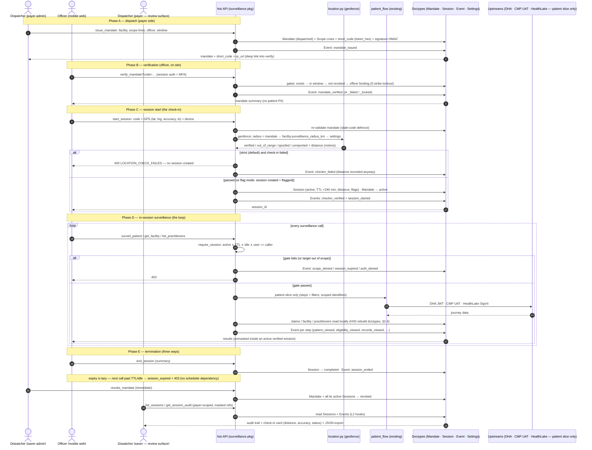

# Claims Surveillance — Feature Specification (BMAD)

| | |
|---|---|
| **Feature** | `claims-surveillance` (mandate → auditable session → location-verified surveillance of facility / patient / claims) |
| **App** | `hisi` (module `Hisi` — Health Information System Interoperability) |
| **Status** | DRAFT — research-benchmarked; Q1/Q3/Q4/Q5 locked 2026-10-30; local rebuild of facility/practitioner doctypes locked 2026-10-30 (no claim doctypes; no global_mediator / healthpro reliance); role names locked 2026-10-30 (`HISI Insurance Provider` dispatches, `HISI Insurance Surveillance` goes to the site); surveilled-only registries reported 2026-10-30; Q10 confirmed 2026-10-30 (draft v1 split — claims stay dispatch context / audit reference; payments/preauth/IPS ride on the shelved journey spec); **Epics 0–3 implemented + verified 2026-10-30** (mandate / session + geofence / scope + surveil + audit endpoints — full app suite 120/120 green on hisi-local); **2026-10-31: payer model refined to the native Frappe `Company` + active `Employee` (the interim `HISI Payer Organization` doctype retired and removed — §7.5), the registries are registry-confirmed at dispatch (DHA facility/practitioner register, `search_facilities`), the officer onboarding endpoints shipped (`list_payer_members` / `onboard_officer` / `remove_officer` — the emailed one-time code is the initial password), and the event catalog carries 28 values; Epic 4 in flight (officer workspace + dispatcher console + Team page done) |
| **Date** | 2026-10-29 (revised 2026-10-31) |
| **Requested by** | irad (irad@tiberbu.com) |
| **Input** | 2026-10-29 request: build a surveillance workflow for claims involving facilities and patients (and possibly practitioners) with (1) validation that the person doing surveillance was sent by the insurance provider, (2) an auditable session-based surveillance in which the person starts a session and selects what to surveil on, and (3) validation that the surveillance personnel was actually at the specified destination. |
| **Reference** | [BMAD Method — ToolSmith](https://docs.bmad-method.org/toolsmith/toolsmith/) |
| **Related** | `patient_flow_api_spec.md` v1.2 (implemented — patient → eligibility → consent → records, reused here); `patient_journey_feature_spec.md` (DRAFT/shelved — surveillance is the enforcement layer over that data lineage); `/dashboard/patients` (existing unattended patient surveillance UI) |

---

## 1. Summary

Hisi gains a **Claims Surveillance** service: an insurer (payer) **dispatches** a surveillance mandate for a facility (and specific claims/patients/visits); a registered **surveillance officer** verifies the mandate on their device, **starts an auditable session** — anchored by a **GPS check-in at the facility** — and within that session surveils the facility, the patient journey (via the existing `patient_flow`), and practitioners (claims remain the dispatch context, not a data surface). **Every action is logged** in an append-only audit trail bound to the session, and the session itself is time-boxed and scope-limited: outside the mandate's scope, nothing is reachable.

Three verification pillars, mapped to the 2026-10-29 request:

1. **Mandate** — proves *who sent the officer and for what* (insurance-provider dispatch, named facility + scope, validity window, one-time code/QR).
2. **Session** — proves *what was done, by whom, when* (started/expired/completed state machine; every surveillance call requires an active session and is logged; TTL + idle timeout).
3. **Location check-in** — proves *the officer was on site* (geofence against the facility's stored coordinates; anti-spoofing layers; strict or flag-on-failure policy).

## 2. Research benchmark (2026-10-29)

How the industry runs exactly this kind of work, and what we adopt:

### 2.1 Insurance field-verification platforms

- **INK LLC (insurance field services)** — the closest analogue to this feature: real-time **task assignment** to field agents (accept → initiate → update on the go); **mobile data capture** (documents, identity proofs, damage/incident images, structured reports + expenses); **every field interaction tagged with precise GPS** plus attendance and distance traveled; **RBAC** with distinct roles (field agent, claim handler, supervisor, QA auditor) and tailored dashboards; "security & transparency built-in — every step logged with **timestamps, GPS metadata, and user identifiers**, fully traceable and auditable."
- **Field investigations in claims processing** (Insurance Clarity Hub) — investigators verify claim allegations against physical evidence, environment, and consistency of statements; evidence practice that makes findings **legally defensible**: photos from multiple angles with scale references, **GPS date/time/metadata attached to every piece of digital evidence**, chronologically organized inventory/log, secure storage, and metadata integrity preserved for disputes.

**Adopted:** the dispatch → on-site capture → GPS-tagged report → RBAC + full logging shape; evidence-grade metadata on every captured artifact.

### 2.2 Geofencing & anti-spoofing state of the art

- **GeoConfirm** — 3-step on-site verification: confirm on arrival → **live GPS read measured against the site's geofence radius** → status `Confirmed` / `Out of range` / `Pending`. Anti-spoofing: **mock-location & tampering detection at the moment of confirmation**, and **single-point capture** (location read once, no background trail to spoof). The defensible record per check-in: employee identity, site, exact time, **distance from site centre in metres**, verification status; one-click CSV/Excel export.
- **Timemoz** — 50 m-precision geofence validation; **automatic detection and blocking of mock-GPS apps**; **selfie stored with every check-in**; out-of-zone clock-ins **automatically flagged as "GPS issues" on a review dashboard**; timestamps "can't be altered", history "can't be unilaterally deleted" (append-only); complete audit logs; encrypted history.
- **Mock-location detection techniques** (OctetProof, Appdome, StackOverflow) — Android: `Location.isMock()` + `ALLOW_MOCK_LOCATION` setting; iOS: `isSimulatedBySoftware`. These flags **only cover specific simulation paths** (jailbreak/code-injection on iOS can evade them), so robust systems add **device integrity checks, cross-signal consistency (GPS vs. network/Wi-Fi), and server-side risk scoring**.
- **Browser limitation (design constraint)** — a web/PWA check-in gets `navigator.geolocation` (lat/lng/accuracy/timestamp) but **no `isMock` equivalent**; detection there is accuracy gating, timestamp freshness, and consistency between repeated fixes. True mock detection requires a native wrapper.

**Adopted:** single-point geofence capture with per-check-in distance recorded; status set `verified / out_of_range / spoofed / unreported`; flagged check-ins routed to a review state rather than silently accepted; append-only, non-deletable check-in history. v1 uses the browser layers; native anti-spoofing (isMock, selfie, device attestation) is a v2 upgrade path (Section 18, Q5).

### 2.3 Auditable-session / audit-trail patterns

- **HIPAA Security Rule** (US benchmark for health-data access): **45 CFR 164.312(b)** — implement "hardware, software, and procedural mechanisms to record and examine activity in systems containing electronic protected health information" (who accessed what, when); **45 CFR 164.316(b)(2)(i)** — keep such documentation **6 years** from the date of creation.
- **Kenya Data Protection Act, 2021** — applies to this platform's data subjects: accountability principle, records of processing, and retention limits. (Exact section references to be confirmed with counsel — Section 18, Q9.)
- **Append-only audit log** (industry standard): event = *who, what, when, where, from where, outcome*; insert-only permissions (no edit/delete granted to any role, not even administrators via the UI); masked identifiers in list views, full values only under privileged read; retention ≥ 6 years for health-data access records.

**Adopted:** a session-scoped, insert-only `HISI Surveillance Event` doctype (Section 10) with the full who/what/when/where/from/outcome event model and a 6-year retention posture.

### 2.4 What this platform provides — and what gets rebuilt locally (decision 2026-10-30)

- **`patient_flow`** (implemented, spec v1.2, 47/47 tests green): patient → eligibility → consent → records via DHA + AWS HealthLake; all tunables in HISI Settings; `APIResponse`-based errors. Surveillance reuses it as the patient slice — the only slice that touches national upstreams (DHA / CMP UAT / HealthLake); facility, claim and practitioner reads are local (the rebuild below).
- **Local rebuild of the facility/practitioner data surveillance reads** (locked 2026-10-30, refined same day): the facility and practitioner data is rebuilt inside the `hisi` app — **no reliance on `global_mediator`, `healthpro`, or the upstream Facility/Practitioner registries at runtime**, and **no claim doctypes** (claims stay the dispatch context / audit reference on the mandate — never a data surface). The cross-app doctypes below are the reference for what the rebuild must cover, not runtime dependencies:
  - **`HISI Health Facility`** (new local doctype; mirrors healthpro `Health Facility`): facility identity (name, facility code/fid, county, level, operational status, license) + `latitude` / `longitude` (Float, precision 7) for the geofence + the dedicated `surveillance_radius_km` Float (Q4). **Facility validation on HISI uses only this doctype** — no Facility Registry lookups, no cross-app fallback. In the surveillance UI it shows **only facilities surveillance has been done on** (rows tied to at least one mandate/session) — a surveilled-target registry, not a full replica.
  - **`HISI Professional Record`** (new local doctype; mirrors healthpro `Professional Record`): practitioner rows (name, cadre, regulator, registration number, facility link). **Professional validation uses only this doctype**, and the UI shows **only practitioners surveillance has been done on** (linked to a surveilled facility). **Surveilled-only is also a report rule (2026-10-30):** the registries hold only what has been surveilled, and the report says so explicitly — the `get_session_audit` export carries a `surveiled_targets` block (the mandate's facility + its practitioners, §10.2).
- **Row scoping (2026-10-31)**: no scripted hooks — every surveillance doctype carries a `company` Link and membership (the active `Employee`) creates the native `User Permission` on the Company; the role matrix (System Manager full; Desk User read; no officer doctype access) + the API-level `require_session` / `is_company_member` gates enforce the rest. The earlier `hisi/permissions.py` L2 hook design (§8.6) was replaced on this basis.
- **`hisi/api/response_handler.py`**: the single response layer (house rule, journey spec §17).

## 3. Goals / Non-Goals

**Goals**
1. Payer-dispatched **mandates** that bind an officer, a facility, a scope (claims/patients/visits), and a validity window — verifiable by the officer via one-time code/QR.
2. **Auditable sessions**: start (with on-site GPS check-in) → surveil → end; time-boxed (TTL + idle), scope-limited, every action logged insert-only.
3. **Location verification** at the facility with anti-spoofing layers appropriate to a web client in v1, and a strict-vs-flag policy in settings.
4. Surveillance surface covering **facility, patient journey (via `patient_flow`), practitioners** (claims stay the dispatch context / audit reference — Q13) — everything the 2026-10-29 request names.
5. A **review surface** (payer dispatcher + platform): session list, per-session audit trail, check-in quality (distance, flags), exportable record.
6. All tunables in **HISI Settings**; no credentials/URLs in code; all responses via `response_handler`.

**Non-Goals (v1)**
- Native mobile app / OS-level mock-location detection, device attestation, selfie capture (v2 upgrade path; browser-geolocation check-in in v1).
- External payer dispatch API (machine dispatch / M2M keys) — deferred to v1.1 per the Q1 resolution; v1 dispatch is the in-platform payer console.
- Real-time live location tracking / trailing the officer (single-point check-in model, per GeoConfirm).
- Persisting journey snapshots, webhooks, or streaming.
- Writing to any upstream registry (read-only; only mandate/session/event rows are written).
- The 14-dimension journey itself (claims value rollups, payments, preauths, IPS, conditions) — that is the shelved Patient Journey spec; surveillance v1 exposes what exists and wraps the rest when the journey ships (Q10).

## 4. Glossary

| Term | Meaning |
|---|---|
| **Payer / insurer** | The insurance provider that dispatches surveillance — modeled as a **Frappe `Company` + role** (refined 2026-10-31; the interim `HISI Payer Organization` doctype of the 2026-10-30 decision was retired and removed): the payer organizations are `Company` records; membership is an active `Employee` on that Company; the dispatcher user holds the `HISI Insurance Provider` role (§7.5). An external payer API is deferred to v1.1 (Q1) |
| **Mandate** | The dispatch artefact: who is sent, to which facility, over which claims/patients/visits, for how long (doctypes in Section 7) |
| **Officer** | The surveillance personnel; a Frappe user with the `HISI Insurance Surveillance` role |
| **Session** | One on-site surveillance engagement: started via mandate verification + location check-in, ends on completion/expiry/revocation |
| **Check-in** | The single-point GPS capture at session start (and optional end / re-checks) |
| **Geofence** | The facility's coordinates + radius used to verify the check-in |
| **Scope line** | One row of what the mandate authorizes surveilling: a claim, a patient, or a visit |
| **Event** | One row of the append-only audit trail, bound to a session |

## 5. User stories

1. **As an insurer (dispatcher)**, I can issue a surveillance mandate naming a facility, specific claims/patients/visits, an officer, and a validity window, so the officer's on-site authority is provable and bounded.
2. **As a surveillance officer on site**, I can verify the mandate with its code/QR and start a session from my device, so I get a working session only if I am the assigned person, within the window, at the facility.
3. **As a surveillance officer in an active session**, I can select a patient/visit in scope and run the journey (identity → eligibility → consent → per-visit records), view the facility's licensing/operational status, and the associated practitioners — nothing else.
4. **As a payer dispatcher**, I can open any session and see the full audit trail — check-in distance and status, every data access with timestamps, duration, and outcome — as an exportable, defensible record.
5. **As a platform admin**, I can revoke a mandate or session immediately, see flagged check-ins (out-of-range / spoofed) on a review list, and confirm the audit log is complete.
6. **As a fraud investigator**, I can see whether a session's check-in was inside the geofence (with metres from facility centre) before trusting its findings.

## 6. Roles & authorization model

| Role | Grants |
|---|---|
| `HISI Insurance Provider` (payer-side) | Issue/revoke mandates for their own payer `Company`; **read sessions + audit for their company** — the review surface sits on this role in v1 (company-scoped: `company` Link + native `User Permission`, §8.6) |
| `HISI Insurance Surveillance` | Verify a mandate (only when assigned to them — Q2), start/end their own sessions, call surveillance endpoints **only inside an active session** |
| System Manager / HISI Reviewer (existing platform roles) | Full access (System Manager in the doctype matrix; the platform read is Desk, the API stays membership-gated) |

Two new surveillance roles in v1 — payer side (Dispatcher) vs. field side (Officer). If a payer later needs read-only audit staff without dispatch rights, a `HISI Surveillance Reviewer` role can be added then; the flow does not require it.

Authorization invariants:
- **Mandate verification** checks: code exists, unexpired, not revoked, `assigned_officer == current user` (Q2), and the mandate is in `dispatched` state.
- **Session calls** check: session active (not expired/ended), `session.user == current user` (officer) or dispatcher/platform role (read surface), and the requested target is inside the mandate scope.
- **No surveillance endpoint is callable without a session** — this is what makes the session the audit boundary: outside it, the officer's role grants nothing.
- Rate limits via `frappe.rate_limiter` on every endpoint (mandate verification tightest — brute-force protection, with a lockout counter after repeated code failures).

## 7. Data model (new doctypes)

### 7.1 `HISI Surveillance Mandate`

| fieldname | fieldtype | notes |
|---|---|---|
| `mandate_no` | Data (auto) | `SURV-<6 chars>` |
| `company` | Link → `Company` | reqd; payer scoping key — the native Frappe `Company` (2026-10-31 refinement of §7.5); membership = an active `Employee` on that company |
| `dispatched_by` | Link → `User` | the dispatcher user |
| `assigned_officer` | Link → `User` | reqd (Q2) |
| `facility` | Link → `HISI Health Facility` | reqd — the destination (local rebuild doctype, §2.4) |
| `reason` | Small Text | reqd — why this surveillance (claim reference, suspicion basis) |
| `scope_lines` | Table → `HISI Surveillance Scope Line` | reqd ≥1 |
| `valid_from` | Datetime | defaults to issue time |
| `expires_at` | Datetime | reqd; mandate unusable after |
| `short_code` | Data, unique | 8-char unguessable (`secrets.token_hex(4)` uppercased); the QR payload |
| `qr_url` | Data | `{site}/api/method/hisi/api/surveillance/verify_mandate?code=…` (deep link so scanning opens the verify flow) |
| `radius_km` | Float | optional per-mandate geofence override (else Q4 resolution order) |
| `location_policy` | Select: `strict` / `flag` | per-mandate override of settings default |
| `status` | Select: `dispatched` / `active` / `completed` / `revoked` / `expired` | lifecycle below |
| `signature` | Data, read_only | HMAC-SHA256 of (company, facility, officer, scope hash, valid_from, expires_at, short_code) with the site key — tamper-evidence for exports |

Mandate lifecycle: `dispatched` → `active` (first successful session start) → `completed` (all scope consumed or expiry with sessions completed) / `revoked` (dispatcher/admin) / `expired` (lazy, on verify attempt).

### 7.2 `HISI Surveillance Scope Line` (child)

| fieldname | fieldtype | notes |
|---|---|---|
| `line_type` | Select: `patient` / `visit` | the claim reference stays on the mandate's `reason` — no claim data surface (Q13) |
| `patient_identifier` | Data | when `patient` (CR ID / National ID — as supplied; resolution via `patient_flow`) |
| `visit_id` | Data | when `visit` (the consent/records `visit_id` — HealthLake `episode-of-care`) |
| `note` | Small Text | per-line context |

Scope semantics: a surveillance call is in-scope if it targets one of these lines, or (for facility-level calls) the mandate's facility. Q6.

### 7.3 `HISI Surveillance Session`

| fieldname | fieldtype | notes |
|---|---|---|
| `session_no` | Data (auto) | `SS-<6 chars>` |
| `mandate` | Link | reqd; read-only after creation |
| `company` | Link → `Company` | copied from the mandate at session start (payer scoping key, 2026-10-31) |
| `user` | Link → `User` | the officer |
| `started_at` | Datetime | |
| `ends_at` | Datetime | started_at + `session_ttl_minutes` (lazy expiry) |
| `last_activity` | Datetime | updated on every in-session call (idle timeout) |
| `location_status` | Select: `verified` / `out_of_range` / `spoofed` / `unreported` | from the check-in |
| `checkin_distance_m` | Float | metres from facility centre at check-in (recorded even when out of range — the review evidence) |
| `checkin_accuracy_m` | Float | device-reported GPS accuracy |
| `checkin_location` | JSON | `{lat, lng, ts, is_mock?, platform}` |
| `device_meta` | JSON | `{platform, app_version, ip, user_agent}` |
| `checkin_flags` | JSON | list of active flags (e.g. `["out_of_range"]`, `["idle_timeout"]`) — doctype field renamed from `flags` 2026-10-30 (collided with Frappe's reserved `Document.flags` attribute, which serialized the internal dict); the API wire key stays `flags` |
| `status` | Select: `active` / `completed` / `expired` / `revoked` | |
| `summary` | Long Text | officer's end-of-session notes (optional) |
| `surveiled_refs` | JSON | append-only per session: the identifiers actually used during the session — patient / claim / visit (from scope) and practitioner refs (viewed via `list_practitioners`) — recorded by the API on each in-scope call, and part of the session report (§10.2) |

### 7.4 `HISI Surveillance Event` (append-only audit trail)

| fieldname | fieldtype | notes |
|---|---|---|
| `session` | Link (idx) | the session (null for mandate-level events such as `mandate_issued`, for onboarding/registry events, and for pre-gate failures that cannot resolve a session — §10.2) |
| `company` | Link → `Company` | the payer `Company` owning the audited record — the session's company when the event sits on a session, else the caller's first active company (null rows stay platform-visible) |
| `user` | Link → `User` | who |
| `event_type` | Select | catalog in Section 10 |
| `target_type` | Select: `patient` / `claim` / `visit` / `facility` / `practitioner` / `record` / `mandate` / `session` / `user` | what (`user` added 2026-10-31 for the onboarding events) |
| `target_ref_masked` | Data | e.g. `CR247…58` — masked identifier for list views |
| `details` | JSON | full context (step names, counts, error codes) |
| `ip` | Data | from where |
| `location` | JSON | check-in events only |
| `outcome` | Select: `ok` / `denied` / `error` / `flagged` | |
| `duration_ms` | Int | |

Permissions (append-only posture, 2026-10-31 matrix): **insert** for System Manager (the API writes via `ignore_permissions` — the officer role holds no doctype permissions); **read** for System Manager and Desk User; **no write, no delete granted to any role** — removal requires an explicit admin script (kept as a control, not a capability). `track_changes` off by design (there are no changes).

### 7.5 Payer model — `Company` + `Employee` (refined 2026-10-31; supersedes the `HISI Payer Organization` doctype of 2026-10-30)

The 2026-10-30 decision modeled the payer as a role **and** a custom registry doctype (`HISI Payer Organization` + member child). On 2026-10-31 that interim doctype was **retired and removed from the app**: the payer organizations are now plain Frappe **`Company`** records, and membership is an active **`Employee`** row (`user_id` + `company` + `status: Active` + `Designation`). Nothing bespoke is needed — it is the same model the platform already uses elsewhere. The SHA-pipeline `HISI Vendor Organization` remains a separate registry; the two are independent (a user may belong to both).

| Concept | Implementation |
|---|---|
| Payer organization | `Company` (native); wire `company` (doc name) + `company_name` (display name) |
| Membership | active `Employee` on that Company — created by `upsert_org_employee` (with `create_user_permission = 1`, so Frappe auto-creates the `User Permission` on the Company) |
| Membership helpers | `active_companies(user)` (companies in membership order), `is_company_member(company, user)`, `upsert_org_employee`, `remove_org_employee` — all in `hisi/utils.py` (they replace `is_payer_member`) |
| Officer designation | `Employee.designation` = `HISI Insurance Surveillance` (the `Designation` record is created on first use) |
| Row scoping | the `company` Link on Mandate / Session / Event + the native `User Permission` + the role matrix + the API gates (`require_session`, `is_company_member`) — no scripted permission hooks |

`issue_mandate` stamps `company` from the caller's **first** active `Company` (never a request parameter); `list_sessions` / `list_mandates` filter on `company` in the caller's companies; `revoke_mandate` / `get_session_audit` gate on `is_company_member`. The onboarding endpoints (added 2026-10-31, API spec §3.15–§3.17) manage this membership: `onboard_officer` creates the User (when new) + the Employee with the officer designation and emails the one-time sign-in code (**the emailed 6-digit code is the initial password** — this build's `User` doctype has no `password_expired_till` column, so forced expiry is not used); `remove_officer` deactivates the Employee (the account survives, self-removal blocked); `list_payer_members` reads the team (the `officer` flag = the surveillance `Designation`; a dispatcher sees themselves — they are a member of their own org).

## 8. API design

Base path: `/api/method/hisi/api/surveillance/…` — new package `hisi/api/surveillance/` (mandate, session, location, audit modules + public surface). All endpoints `@frappe.whitelist()` (no `allow_guest`), wrapped in `api_endpoint`, rate-limited, responding via `APIResponse` (house rule, journey spec §17).

### 8.1 Endpoints

| Endpoint | Method | Who | Purpose |
|---|---|---|---|
| `issue_mandate` | POST | Dispatcher | Create mandate + scope lines; returns mandate with `short_code` + `qr_url` |
| `verify_mandate` | GET/POST | Officer (or scanner deep-link) | Validate code → mandate summary **without patient PII** (facility name, scope counts, validity); failure → `BAD_REQUEST` + lockout counter |
| `start_session` | POST | Officer | Verified mandate + check-in payload → geofence check (Section 9) → create session; in `strict` mode, failed check-in → `400 LOCATION_CHECK_FAILED` (no session); in `flag` mode → session active with flag |
| `get_session` | GET | Officer | Session state: status, time remaining, location result, scope lines (masked), mandate summary |
| `surveil_patient` | POST | Officer | Runs `patient_flow` (steps + filters per the existing contract) **restricted to scope lines**; each executed step logged as an event |
| `get_facility` | GET | Officer | `HISI Health Facility` detail: license, operational status, level, coordinates (not the geofence internals) |
| `list_practitioners` | GET | Officer | `HISI Professional Record` rows linked to the mandate facility or in-scope claims/visits |
| `recheck_location` | POST | Officer | Optional mid-session re-check-in (same payload/checks as start) — Q7 |
| `end_session` | POST | Officer | Optional final check-in + summary; marks `completed` |
| `list_sessions` | GET | Dispatcher | Sessions in the payer org, with `location_status` + flags (flagged ones surface in the review UI) |
| `get_session_audit` | GET | Dispatcher | Full event list for a session (who/what/when/where/outcome) + check-in record + the recorded identifiers (`surveiled_refs`) |
| `revoke_mandate` | POST | Dispatcher (members of the mandate's `Company`) | Revoke mandate → all its active sessions revoked |
| `search_facilities` | GET/POST | Dispatcher | DHA facility register search — the dispatch picker; the picked exact name is registry-confirmed at issue (added 2026-10-31) |
| `list_payer_members` | GET | Dispatcher | The caller's company members (officer team; `officer` flag = the surveillance `Designation`) — added 2026-10-31 |
| `onboard_officer` | POST | Dispatcher | Create/reuse the user + active `Employee` with the officer designation; a brand-new account's **emailed one-time code is the initial password** — added 2026-10-31 |
| `remove_officer` | POST | Dispatcher | Deactivate the member's `Employee` row(s) (the account survives; self-removal blocked) — added 2026-10-31 |

### 8.2 Mandate flow

```
Payer admin (dispatcher)                 Officer (on site)
issue_mandate(facility, scope[],          verify_mandate(code)
  officer, window, policy)          →     {mandate_no, facility, scope counts,
  → {mandate, short_code, qr_url}           expires_at, assigned_to: me?}
                                       start_session(check_in)
                                       → geofence → session (active)
                                       [surveil_* calls, each logged]
                                       end_session()
```

- `short_code` is 8 chars from `secrets.token_hex(4)` — unguessable; verification is rate-limited and after **5 consecutive failures** against a code the code is locked (event `mandate_verify_locked`, Q-confirmed default).
- `qr_url` deep-links straight into `verify_mandate?code=…` so scanning on the officer's phone opens the verify screen; the officer must still be logged in (session auth) — the QR authorizes *which mandate*, never identity.

### 8.3 Session flow & invariants

- **Start** = `verify_mandate` (or an already-verified code) + check-in payload. The server performs the **single-point** location check at that moment (no client-side geofence logic — the client reports, the server decides).
- **Active window**: `ends_at = started_at + session_ttl_minutes` (default 240); `last_activity` refreshed per call; idle beyond `idle_timeout_minutes` (default 30) → next call finds the session `expired` (lazy — no background job required; a nightly job only back-fills status for reporting).
- **Scope enforcement**: `surveil_patient` rejects patients not on a scope line; `get_facility` / `list_practitioners` surface **only** the surveilled facility and its practitioners (rows tied to the mandate — nothing else, Q13). Out-of-scope → `403 FORBIDDEN` + event `outcome: denied`.
- **Revocation** is immediate (status flip; every subsequent call 403s with `MANDATE_REVOKED`).

### 8.4 Request contracts (key payloads)

Check-in payload (start_session / recheck_location):

```json
{
  "session": {"mandate_code": "8F3A2C91"},
  "location": {
    "lat": -1.2833, "lng": 36.8219, "accuracy_m": 18,
    "ts": "2026-10-29T10:14:03Z",
    "is_mock": false, "platform": "web"
  },
  "device": {"app_version": "1.4.2", "user_agent": "…"}
}
```

`surveil_patient` reuses the `patient_flow` contract verbatim:

```json
{ "session_id": "SS-291029A", "steps": ["patient", "eligibility", "consent", "records"],
  "filters": { "identification_type": "National ID", "identification_number": "36637305" } }
```

(identifiers not on a scope line → `403 FORBIDDEN` + denied event.)

### 8.5 Error contract (via `response_handler`)

| HTTP | code | When |
|---|---|---|
| 400 | `BAD_REQUEST` | malformed payload, missing scope line, check-in payload invalid/absent |
| 400 | `MANDATE_INVALID` | code unknown/expired/revoked/locked (no PII in message) |
| 400 | `LOCATION_CHECK_FAILED` | strict mode + check-in failed (message carries the reason: out_of_range / spoofed / stale) |
| 401 | `UNAUTHORIZED` | not logged in / not the assigned officer |
| 403 | `FORBIDDEN` | out-of-scope target, wrong role, session inactive/expired/revoked |
| 404 | `NOT_FOUND` | patient/practitioner not found in scope |
| 429 | rate-limit | `frappe.rate_limiter` exhausted |
| 400/502 | `UPSTREAM_ERROR` | `patient_flow` national-upstream failure (DHA / CMP UAT / HealthLake; propagated — facility/claim/practitioner reads are local and cannot raise it) |
| 500 | `INTERNAL_ERROR` | unexpected (logged) |

### 8.6 Control & authorization architecture (HISI/Frappe mapping)

All control lives **server-side in the `hisi` app**. The Next.js layer stays a zero-trust proxy: allow-listed `surveillance.*` operations with the user's session forwarded — no scope logic, no geofence math, no tokens in the browser.

**L0 — Identity (existing, unchanged).** Frappe session/token auth on every endpoint (no `allow_guest`); MFA email OTP for all users (BRD Q-9). The mandate QR encodes only `{site}/api/method/hisi/api/surveillance/verify_mandate?code=…` — it selects *which mandate*; identity is always the Frappe session.

**L1 — Static authorization: roles + doctype permissions** (the pattern the existing hisi doctypes already use in their `.json` files):

| Doctype | Dispatcher | Officer | System Manager |
|---|---|---|---|
| `Mandate` | read (own company — `company` Link + `User Permission`) | — (API only) | full |
| `Scope Line` | (child of mandate) | — | full |
| `Session` | read (own company) | read — own only (API `require_session`) | full |
| `Event` | read (own company) | — (API writes via `ignore_permissions`) | read + create — **no delete granted to any role** |

(2026-10-31 matrix, as installed: the rows above plus **Desk User read** on every surveillance doctype for Desk visibility; no rows for the `HISI Insurance Provider` / `HISI Insurance Surveillance` roles.)

The officer has **no** doctype-level access to any surveillance doctype; every officer interaction flows through the whitelisted API (the API writes with `ignore_permissions`). Row scoping for the payer read is native — the `company` Link + the `User Permission` auto-created by the member's `Employee` — not a scripted hook. Doctype permissions are the Desk-UI backstop, not the primary control.

**L2 — Dynamic authorization (the actual enforcement).**
- **Native row scoping (2026-10-31 — the scripted `hisi/permissions.py` hooks were removed):** the `company` Link on every org-scoped doctype + the native `User Permission` on `Company` (auto-created when the member's `Employee` is upserted with `create_user_permission = 1`) scopes the payer's rows; the membership helpers live in `hisi/utils.py` (`active_companies`, `is_company_member`). The API layer keeps its own gates regardless (below).
- **`require_session` gate in the API**: every `surveil_*` / `get_*` / `end_session` call resolves the session — status `active`, within TTL, idle not exceeded, `user == caller`, target inside the mandate scope. This is where "no session, no data" is actually enforced; role permissions cannot express session scope.
- **`User Permission` now carries the *company* scope, not the session scope (2026-10-31):** the grant is per payer-`Company` (created with the `Employee`, never per session), so it is static and auditable; the session scope is dynamic and mandate-driven, and remains enforced exclusively in `require_session` — a permission can never express it, and the one-event-per-call audit test keeps that gate honest.

**L3 — Operational control (surveillance-specific, all server-side).**
- **Mandate gate** — in `verify_mandate`: code existence, validity window, revocation, officer binding, 5-strike lockout.
- **Location gate** — in `location.py`: haversine + accuracy + freshness + status matrix; the client reports, the server decides (even `is_mock` is an input, not a verdict).
- **Lifecycle** — TTL + idle as lazy checks in `require_session` (no scheduler dependency); a nightly `scheduler_events` job only back-fills `expired` status for reporting.
- **Rate limiting** — `@frappe.rate_limiter.rate_limit` on every endpoint (Frappe native, cache-based counters); tightest on `verify_mandate`.
- **Audit — two tiers** (both verified in this bench):
  - **Native `Access Log`** already records every `/api/method` call (user, method, timestamp; deferred insert). Boundaries: System Manager read only; `clear_old_logs` purges ~30 days; no session/mandate/location context → forensic second layer, not the retention record.
  - **`HISI Surveillance Event`** is the audit record of record: session-scoped, insert-only (no role holds delete), 6-year retention posture.
  - **Doctype tamper-evidence** — Frappe soft-delete (deletions land in `deleted_document`, never hard-deleted) + `track_changes` versioning, viewable in the native `Audit Trail` report: every field change to a mandate/session is versioned. The mandate `signature` HMAC proves export integrity; version history proves in-system integrity.

**L4 — Frontend (hisi_app): zero-trust viewer.** Server proxy forwards allow-listed operations with the user's session; the browser's geolocation is a sensor, not a control. The `surveillance.*` operations land in `lib/server/operations.ts` + the zod contract in the same change as the endpoints (the allow-list drift lesson, 2026-10-23).

**Boundary statement — what each layer does NOT prove:**
- Role permissions (L1) do not prove session scope — that is `require_session` (L2); the audit-completeness test (exactly one event per call) is the gate that proves the gate exists on every endpoint.
- MFA (L0) proves identity at login, not device binding — a stolen credential can still start a session; the mandate→officer binding plus the on-site check-in bounds the damage.
- The native `Access Log` (L3) does not prove compliance retention — its ~30-day purge; only the Event doctype does.
- `checkin_distance_m` is the distance of the **client-reported** coordinate from the facility centre (server-computed) — it is not proof of presence: a spoofed fix still reads as close. v1 anti-spoofing flags; it does not prove the officer was on site.

---

### 8.7 Sequence flow — how the implementation is tied together



**Reading the diagram:**
- Every arrow crosses one trust boundary — the **hisi_app allow-list proxy** (L4) forwards session-authenticated `surveillance.*` operations; the browser never talks to Frappe directly, and the QR deep link lands on `verify_mandate?code=…` through the same proxy.
- **Phase D's gate** is `require_session` (L2): it runs before any business logic on every call, and TTL/idle expiry happens lazily inside it — the nightly job only back-fills status for reporting.
- **Exactly one `HISI Surveillance Event` per arrow** — including every failed branch (the 400/401/403 alt legs). That is what §15.2 asserts; event writes are best-effort per §10.2.
- The **patient slice** delegates to the implemented `patient_flow` unchanged; only it touches upstreams — facility/practitioner reads are local `HISI Health Facility` / `HISI Professional Record` reads of the surveilled target only (the 2026-10-30 local rebuild, §2.4); claims are dispatch context, never read.
- The **dispatcher's review surface never appears in Phases A–D** — it only reads, via `list_sessions` / `get_session_audit` (payer-scoped, masked refs), and sees the check-in card (distance in metres, accuracy, status) plus the full event trail.

---

## 9. Location verification design

### 9.1 Geofence

- Centre: `HISI Health Facility.latitude/longitude` (local rebuild doctype, precision 7).
- Radius resolution order (first non-null wins): `mandate.radius_km` → `HISI Health Facility.surveillance_radius_km` (dedicated Float field — Q4 resolved 2026-10-30, now on the local rebuild doctype: no cross-app change; the preauthorization `recommended_perimeterkm` concept is NOT reused) → HISI Settings `surveillance_default_radius_km` (default `1.0`).
- Distance: haversine, metres, server-computed. `checkin_distance_m` is recorded **always** — it is the primary review evidence (GeoConfirm benchmark: the record carries the exact distance from site centre).

### 9.2 Check-in status matrix

| Condition | Status | Effect (strict) | Effect (flag) |
|---|---|---|---|
| dist ≤ radius ∧ accuracy ≤ `max_accuracy_m` (200) ∧ !is_mock ∧ fresh ts (≤ 2 min) | `verified` | session active | session active |
| dist > radius | `out_of_range` | `400 LOCATION_CHECK_FAILED`; no session; event logged | session active + flag `out_of_range`; every in-session call tagged; dispatcher sees it |
| `is_mock == true` (client-reported) | `spoofed` | same as out_of_range | session active + flag `spoofed` (dispatcher alert) |
| accuracy > 200 m or stale ts | `out_of_range` (reason in event) | same | same |
| no location payload (desk web, geolocation denied) | `unreported` | no session | session active + flag `unreported` |

### 9.3 Anti-spoofing layers (v1 = web client)

1. **Single-point capture** — location read once at confirmation (no client-side trail to replay).
2. **Accuracy gate** — device-reported `accuracy_m` above threshold → fail.
3. **Timestamp freshness** — server rejects `ts` older than 2 minutes (replay defence).
4. **Client `is_mock` self-report** — web browsers expose no mock flag; the client sets `is_mock` only where the platform allows it (native v2), and the server never trusts a client that *omits* it after a prior `spoofed` attempt from the same session (consistency check between check-ins).
5. **Consistency** — mid-session `recheck_location` (Q7) compares the new fix against the check-in (impossible-jump check: > 5 km/h implied speed between fixes at the same facility → flag).
6. **v2 native upgrade path** (out of scope v1): `Location.isMock()` (Android) / `isSimulatedBySoftware` (iOS) + `ALLOW_MOCK_LOCATION` inspection, device integrity checks, cross-signal (Wi-Fi) consistency, selfie capture — per Section 2.2 benchmark.

## 10. Audit trail design

### 10.1 Event catalog

`mandate_issued`, `mandate_verified`, `mandate_verify_failed`, `mandate_verify_locked`, `mandate_revoked`, `checkin_verified`, `checkin_failed`, `session_started`, `session_expired`, `session_ended`, `session_recheck`, `patient_viewed`, `eligibility_viewed`, `consent_viewed`, `records_viewed`, `facility_viewed`, `practitioner_viewed`, `scope_denied`, `auth_denied`, `error`, plus the contract additions `sessions_listed`, `audit_viewed`, `mandate_listed`, `session_revoked` (API spec §4 — folded into the Event doctype options + test suite; `mandate_listed` added 2026-10-30 with S4.3) and the 2026-10-31 additions `officer_onboarded`, `officer_removed`, `members_listed` (Team page), `facilities_searched` (registry search), `practitioner_registered` (registry back-fill in `list_practitioners`) — the doctype's `event_type` options now carry all 28 values.

### 10.2 Invariants

- **Exactly one event per API call** (success, denial, or error) — enforced in tests (15.2). Pre-gate failures that cannot resolve a session (400/401 on a missing/malformed `session_id`, unauthenticated calls) write a **session-null** event (`event_type: auth_denied` when identity/role fails, else `error`), with IP and user where known.
- **Event writes are best-effort, not transactional with the action** — if the event insert itself fails, the API call still returns its own response, the failure is logged via `frappe.log_error`, and (where a session exists) the session is flagged `audit_degraded`. The “complete by construction” claim therefore holds for the happy path and the test suite — not for a failed event insert.
- Events carry `ip`, and for location events the full check-in payload; `target_ref_masked` in every row; full identifiers only inside `details` (privileged read).
- Insert-only: no role holds write/delete (Section 7.4).
- **Retention: 6 years** minimum for health-data access records (HIPAA 164.316(b)(2)(i) benchmark; Kenya DPA 2021 retention duties — counsel to confirm, Q9). Rows are never auto-deleted; archiving to cold storage is a v2 ops concern.
- **Export**: `get_session_audit` returns the session (including `surveiled_refs` — the patient / claim / visit identifiers and practitioner refs actually used in the session) + events as a JSON envelope (CSV/PDF export of the record in v1.1) + the `surveiled_targets` block — the mandate's `HISI Health Facility` row and its `HISI Professional Record` rows (the registries are surveilled-only by construction, so the report enumerates exactly what has been surveilled) — the "defensible, exportable record" benchmark (GeoConfirm).

## 11. Security & PII

1. All endpoints session/token auth; no guest; rate limits on every endpoint, tightest on `verify_mandate`.
2. The mandate code authorizes **which mandate**, never identity — the Frappe session is always the identity source.
3. PII policy: inside an active, verified session, the officer sees **unmasked** journey data (that is the surveillance function — Q12 confirms); list views, audit rows, and exports use masked identifiers except under privileged read.
4. `signature` (HMAC) on the mandate makes exports tamper-evident.
5. Upstream PII handling inherits `patient_flow` guarantees (DHA JWT / SigV4 never exposed; secrets in settings via Password fields).
6. Kenya DPA 2021: the event doctype doubles as the platform's processing record for surveillance data access; data subjects are patients (via upstream) and officers (device metadata). Counsel review flagged (Q9).
7. No journey data in URLs; check-in coordinates travel in POST bodies; GET query params for identifiers are marked PII-sensitive in the access log.

## 12. HISI Settings — Surveillance tab (new)

| fieldname | fieldtype | label | default |
|---|---|---|---|
| `surveillance_tab` | Tab Break | Surveillance | |
| `surveillance_session_ttl_minutes` | Int | Session TTL (minutes) | 240 |
| `surveillance_idle_timeout_minutes` | Int | Idle timeout (minutes) | 30 |
| `surveillance_default_radius_km` | Float | Default geofence radius (km) | 1.0 |
| `surveillance_max_accuracy_m` | Int | Max GPS accuracy (metres) | 200 |
| `surveillance_strict_location` | Check | Strict location (block on failed check-in) | 1 |
| `surveillance_recheck_enabled` | Check | Allow mid-session re-check-in | 1 |
| `surveillance_verify_lockout_attempts` | Int | Mandate code failures before lock | 5 |
| `surveillance_retention_days` | Int | Audit retention (days) | 2192 (≈ 6 years) |

House rule (inherited): **no tunable constant in code** — every radius/TTL/limit lives here; unset required values fail fast with a named `BAD_REQUEST`.

## 13. UI plan (hisi_app — Next.js)

- **Nav** (dashboard-shell): new item **"Claims surveillance"** (`PatientFlowIcon`-adjacent icon; distinct from the commented-out "Claims and traces" — do not touch that comment, per standing instruction).
- **Officer workspace** `/dashboard/surveillance`: mandate code entry/QR-scan (deep-link lands here) → verify screen (facility, scope summary, validity) → **start-session** with geolocation capture (accuracy + distance feedback) → in-session surface: scope-line picker → journey (reuses the `/dashboard/patients` step components for patient → eligibility → consent → records) → facility panel (the surveilled facility) → practitioners list (surveilled practitioners only) → end-session with summary.
- **Dispatcher console** (payer role): issue mandate (facility picker, scope lines, officer picker, window, policy) with the generated QR shown for sharing; revoke.
- **Review** `/dashboard/surveillance/sessions`: session list with `location_status`/flags (flagged rows highlighted — the "GPS issues" dashboard pattern); session detail = audit trail table (who/what/when/where/outcome) + check-in card (distance in metres, accuracy, status) + the recorded identifiers used (`surveiled_refs`) + the surveiled-targets block (facility + practitioners) + export.
- Operations land in `lib/server/operations.ts` (`surveillance.*`) with zod schemas in `lib/operations-contract.ts`; browser geolocation via `navigator.geolocation` with the client setting `is_mock: false` only where detectable (web → omitted flag, server-side freshness/accuracy/consistency still apply).

## 14. Acceptance criteria

1. A mandate issued by a dispatcher cannot be verified by any officer other than the assigned one; an expired/revoked/unknown code yields `MANDATE_INVALID` with no PII in the message; 5 consecutive failures lock the code (event recorded).
2. `start_session` from within the geofence (≤ radius, accuracy ≤ 200 m, fresh ts) → `verified`, distance in metres recorded; from outside → `out_of_range` (strict: no session created; flag: session flagged, every call logged with the flag); `is_mock: true` → `spoofed` under both policies.
3. Every `surveil_*` / `get_*` call inside an active session writes exactly one `HISI Surveillance Event` row with ip, timestamp, and masked target; out-of-scope targets return `403 FORBIDDEN` + a `scope_denied` event.
4. An officer with no active session gets `403`/`401` from every surveillance endpoint (the role alone grants nothing).
5. TTL expiry (default 4 h) and idle timeout (default 30 min) both terminate access on the next call (lazy), logged as `session_expired`.
6. `revoke_mandate` kills all active sessions for that mandate immediately; subsequent calls 403 with `MANDATE_REVOKED`.
7. `get_session_audit` returns the complete, ordered event list for a session plus the identifiers actually used (`surveiled_refs`); the event doctype exposes no delete permission to any role.
8. The full journey from a scope line: `surveil_patient` returns patient/eligibility/consent/records via the existing `patient_flow` contract, unchanged in shape.
9. All settings in Section 12 exist in HISI Settings and drive behaviour (radius override via mandate > facility field > settings default — verified per Q4).
10. `bench --site hisi-local run-tests --app hisi` green (new suite + existing 47).

## 15. Test plan

- **15.1 Geofence unit** — haversine edges (radius boundary ±1 m, Kenya coordinates), accuracy/stale/mock matrices, radius resolution order, strict-vs-flag outcomes.
- **15.2 Audit completeness** — for every endpoint × {success, denied, error}: exactly one event, correct `event_type`/`outcome`; pre-gate failures produce session-null events; a failed event insert produces the `audit_degraded` flag + `log_error`; append-only assertion (no delete path resolves).
- **15.3 Mandate lifecycle** — issue → verify → start → complete; expiry, revocation, code lockout, substitution denial.
- **15.4 Session lifecycle** — start/active/idle-expire/TTL-expire/end; scope enforcement across patient/visit/practitioner; upstream failure propagation from `patient_flow`.
- **15.5 Integration (mocked upstream)** — `patient_flow` steps mocked; check-in payloads replayed (stale ts rejected).
- **15.6 e2e (Playwright, existing setup)** — dispatcher issues → officer verifies + check-in (mocked browser geolocation) → journey → end → audit view renders flagged row for an out-of-range case.

## 16. Implementation notes (file map)

| File | Change |
|---|---|
| `hisi/hisi/doctype/hisi_surveillance_mandate/` | New (mandate + child scope line doctype) |
| `hisi/hisi/doctype/hisi_surveillance_session/` | New |
| `hisi/hisi/doctype/hisi_surveillance_event/` | New (append-only permissions) |
| `hisi/hisi/doctype/hisi_payer_organization/` | **Removed 2026-10-31** — interim payer registry retired; the payer model is native `Company` + active `Employee` (§7.5, Q1) |
| `hisi/utils.py` | `active_companies` / `is_company_member` / `upsert_org_employee` / `remove_org_employee` (Company + Employee membership; `is_payer_member` retired 2026-10-31) |
| `hisi/api/surveillance/__init__.py` | Package, public surface |
| `hisi/api/surveillance/mandate.py` | `issue_mandate`, `verify_mandate`, `revoke_mandate` (+ lockout) |
| `hisi/api/surveillance/session.py` | `start_session`, `get_session`, `end_session`, `recheck_location` |
| `hisi/api/surveillance/location.py` | Haversine, status matrix, radius resolution, freshness/mock checks |
| `hisi/api/surveillance/scope.py` | Scope resolution + in-scope enforcement for journey/claims/practitioners |
| `hisi/api/surveillance/audit.py` | Event writes, `list_sessions`, `list_mandates`, `get_session_audit`, export envelope |
| `hisi/api/surveillance/api.py` | `get_facility`, `list_practitioners` (+ DHA registry back-fill), `surveil_patient` (thin `patient_flow` wrapper) |
| `hisi/api/surveillance/facilities.py` | `search_facilities` — DHA facility register search (the dispatch picker; registry-confirmed rows seed the local registry on first issue) — added 2026-10-31 |
| `hisi/api/surveillance/onboarding.py` | `list_payer_members`, `onboard_officer`, `remove_officer` (officer team; emailed one-time code = initial password) — added 2026-10-31 |
| `hisi/permissions.py` | **Surveillance hooks removed 2026-10-31** — row scoping is native (`company` Link + `User Permission`); no scripted permission hooks |
| `hisi/hisi/doctype/hisi_settings/hisi_settings.json` | Surveillance tab + Section 12 fields; register endpoints (`base_url` + `fetch_facility` / `fetch_practitioner`, UAT simulation base) for the facility/practitioner register reads |
| `hisi/hisi/doctype/hisi_health_facility/` | New — facility identity + coordinates (precision 7) + `surveillance_radius_km` Float (Q4) + `registered_by` (the dispatching company); local rebuild, replaces the cross-app healthpro change (§2.4); holds **only surveilled facilities** (row auto-created from the **registry-confirmed** DHA register row on first dispatch, 2026-10-31) |
| `hisi/hisi/doctype/hisi_professional_record/` | New — practitioner rows (name, cadre, regulator, registration number, facility link, `registered_by`); **only practitioners of surveilled facilities** (auto-registered from the DHA practitioner register on first `list_practitioners` call, 2026-10-31) |
| `hisi/tests/test_surveillance.py` | 15.1–15.5 |
| `hisi_app/lib/server/operations.ts` + `operations-contract.ts` | `surveillance.*` operations + zod — 18 wired as of 2026-10-31 (the 17 mandate/session + onboarding ops + `search-facilities`; the dispatch facility picker is wired — debounced registry search, exact-name pick; the stale `facility_detail` input and free-text field are retired) |
| `hisi_app/app/dashboard/surveillance/…` | Officer workspace (done 2026-10-30), dispatcher console (issue + QR + mandate register; the facility picker is wired to `search_facilities` — debounced registry search with exact-name pick, 2026-10-31; the officer field picks from `list_payer_members` confirmed officers only — active membership + surveillance designation, issue gated on the pick, 2026-10-31), `/dashboard/team` officer-onboarding page (done 2026-10-31), sessions/review pages |

Style: house rules per journey spec §17 (single response layer via `response_handler`, no docstrings, no private names, one blank line between functions, pydantic for request/response shapes).

**Phased plan:** P0 — confirm Section 18 decisions → P1 — doctypes + settings + permissions → P2 — mandate API + QR → P3 — session + geofence check-in → P4 — surveillance endpoints + audit → P5 — UI (officer + dispatcher + review) → P6 — hardening (e2e, export, lockout, retention) → **v2**: native anti-spoofing wrapper, periodic re-checks, Patient Journey spec integration when green-lit, cold-storage archival.

## 17. Cross-cutting engineering rules

Inherited unchanged from the Patient Journey spec §17: single response layer (`hisi/api/response_handler.py`), no docstrings, no private names, one blank line between functions/classes, pydantic for validated/serialized shapes — and **no tunable constant in code**.

## 18. Open questions (need user's call before implementation)

1. **Who dispatches?** — **Resolved 2026-10-30: in-platform payer; refined 2026-10-31 — the payer is a native `Company` + role (the interim `HISI Payer Organization` doctype was retired and removed).** (1) The `HISI Insurance Provider` role on the payer's staff users; (2) the payer organizations are `Company` records with active-`Employee` membership (§7.5) — the same model as the rest of the platform; the SHA-pipeline `HISI Vendor Organization` doctype is **not** the payer's. Dispatch runs from the dashboard console. External payer API (machine dispatch / M2M keys) deferred to v1.1.
2. **Officer substitution** — mandate bound to exactly one named officer (draft), or a payer roster (any of N officers may accept)?
3. **Strict vs flag default** — **Resolved 2026-10-30: strict (block)** as the global default; the per-mandate `location_policy` override to `flag` remains available for poor-GPS sites.
4. **Geofence radius authority** — **Resolved 2026-10-30: dedicated field.** New `HISI Health Facility.surveillance_radius_km` on the local rebuild doctype (the 2026-10-30 rebuild decision retired the cross-app healthpro change); order per §9.1 — mandate override → facility field → settings default.
5. **Check-in surface** — **Resolved 2026-10-30: mobile web v1 + flagged review.** Browser geolocation with accuracy/freshness/consistency checks; spoofing risk covered by flagged review; the native wrapper (isMock, selfie, device attestation) ships as the v2 upgrade.
6. **Scope granularity** — named scope lines (specific patients/visits), per-facility (all patients/visits in the window), or both? Affects how `surveil_patient` resolves the in-scope set.
7. **Mid-session re-checks** — enabled by default (draft) with a 2 h cadence? Battery/UX cost vs. confidence.
8. **Photo/selfie evidence** — off in v1 (privacy); do any mandates require photo evidence at check-in (v1.1)?
9. **Kenya DPA 2021** — confirm the exact statutory basis for the 6-year retention + audit duties (counsel); adjust `surveillance_retention_days`.
10. **Journey dimensions** — v1 covers patient journey (existing) + facility + practitioners (claims are dispatch context / audit reference only, no data surface — Q13). Payments/preauths/IPS/conditions ride on the shelved Patient Journey spec — confirm that split.
11. **TTL/idle defaults** — 4 h session / 30 min idle: realistic for a field visit?
12. **PII inside session** — draft: unmasked inside active verified session, masked everywhere else. Confirm (privacy posture for the officer's device).
13. **Local rebuild of facility/practitioner data** — **Resolved 2026-10-30: rebuild in HISI, no cross-app reliance, no claim doctypes.** `HISI Health Facility` and `HISI Professional Record` are rebuilt as local doctypes of the `hisi` app (§2.4) — facility/professional validation uses **only** these two — no `global_mediator`, no `healthpro`, no upstream Facility/Practitioner Registry lookups. **No claim doctypes are built**: the claim dimension stays the dispatch context / audit reference on the mandate (`reason`), never a data surface — `list_claims` / `get_claim` / `claim_viewed` are out of v1. In the UI, the facility panel and practitioners list show **only facilities/practitioners surveillance has been done on** (rows tied to a mandate/session). The identifiers actually used in a session — patient / claim / visit (scope) and practitioner refs — are recorded as part of the session report (`surveiled_refs`, §7.3) — identifiers only, never claim data. The national patient upstreams (DHA / CMP UAT / HealthLake via `patient_flow`) are untouched by this decision.

---

*Generated 2026-10-29 as a research-benchmarked BMAD feature spec for the `hisi` app; Q1/Q3/Q4/Q5 locked 2026-10-30; local rebuild of facility/practitioner doctypes locked 2026-10-30 (no claim doctypes; no global_mediator / healthpro reliance — §2.4, Q13); payer registry doctype `HISI Payer Organization` locked 2026-10-30 (payer = role + doctype — §7.5, Q1). Q10 confirmed 2026-10-30 (draft v1 split); Epics 0–3 implemented + verified 2026-10-30 (mandate dispatch / verify + 5-strike lockout / revoke; session + geofence check-in; scope gate + `surveil_patient` / `get_facility` / `list_practitioners` + `list_sessions` / `get_session_audit` — full app suite 120/120 green on hisi-local); **2026-10-31: payer model refined to native `Company` + active `Employee` (interim `HISI Payer Organization` doctype retired and removed — §7.5, Q1), facility/practitioner registries registry-confirmed at dispatch, officer onboarding shipped (emailed one-time code = initial password), 28-value event catalog; Epic 4 in flight (officer workspace + dispatcher console + Team page)**; next per `claims_surveillance_epics.md`: rest of Epic 4 (sessions review, e2e) → 5. The Patient Journey spec stays shelved until the user green-lights it; this surveillance feature is the enforcement layer that would wrap it when it ships.*
